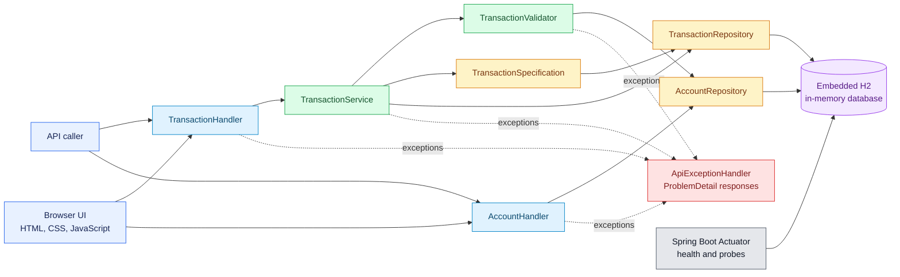

# Banking Transaction Service

## 1. Service at a Glance

This project is an MVP banking transaction-management service built with Java 17 and Spring Boot. It exposes a REST API and a small browser interface for recording, viewing, correcting, filtering, and soft-deleting transactions. Accounts are fixed seed data, and all application data is stored in an embedded H2 database.

> **Temporary data:** H2 runs in memory with a `create-drop` schema. Restarting the application or replacing its container or pod restores the seed data and discards runtime changes.

### 1.1 Delivered Capabilities

**Transaction lifecycle**

- Create transactions between different active seed accounts.
- Retrieve transactions by their generated identifiers.
- Correct mutable fields while preserving each transaction's reference and participants.
- Soft-delete transactions for audit without physically removing their database rows.
- Hide soft-deleted transactions from subsequent item, list, update, and delete operations.

**Search and presentation**

- List visible transactions using zero-based pagination and deterministic ordering.
- Find account activity where the account is either the sender or recipient.
- Combine account, time range, currency, and category filters.
- Manage transactions through a responsive browser interface served by the application.

**Data integrity and failure handling**

- Preserve the uniqueness of `clientReference`, including references on soft-deleted rows.
- Validate request fields, account state, supported currencies, time ranges, and occurrence timestamps.
- Return actionable RFC 9457-style problem responses for client and server failures.

**Operations and verification**

- Expose application health, liveness, and readiness endpoints through Spring Boot Actuator.
- Build and deploy the service with Maven, Docker, or the supplied Kubernetes manifests.
- Verify business rules, persistence, HTTP contracts, and load behavior with automated tests and k6.

The default currency allow-list is `SGD`, `CNY`, `USD`, and `HKD`. The optional categories are `TRANSFER`, `BILL`, `SHOPPING`, and `OTHER`.

The seeded accounts are:

| Account ID | Account type | State | Transaction eligibility |
|---|---|---|---|
| `ACC-001` | `CURRENT` | Active | Sender or recipient |
| `ACC-002` | `SAVINGS` | Active | Sender or recipient |
| `ACC-003` | `CURRENT` | Active | Sender or recipient |
| `ACC-999` | `CURRENT` | Inactive | Rejected by create validation |

Two example transactions, `SEED-0001` and `SEED-0002`, are also created at startup.

## 2. System Structure and Runtime Flow

The application is a single Spring Boot deployment organized into API, service, domain, persistence, configuration, and error-handling packages.

- The static HTML, CSS, and JavaScript UI calls the same REST endpoints available to external callers.
- `TransactionHandler` and `AccountHandler` own HTTP request binding and response status selection.
- `TransactionService` defines transaction boundaries and implements create, retrieve, list, update, and soft-delete workflows.
- `TransactionValidator` enforces account, currency, timestamp, and query-range business rules.
- `TransactionSpecification` builds composable JPA predicates and always excludes rows with a non-null `deletedAt`.
- `TransactionRepository` and `AccountRepository` provide Spring Data JPA persistence access.
- `ApiExceptionHandler` converts validation, binding, business, and unexpected failures into a consistent problem response.
- `DemoDataSeeder` creates the fixed account catalogue and representative transactions when seeding is enabled.
- A shared UTC `Clock` supplies integer Unix epoch-millisecond audit and error timestamps.
- Actuator provides health information for operators and Kubernetes probes.



### 2.1 Technology Profile

| Area | Selected technology | Implementation details |
|---|---|---|
| Language runtime | Java 17 | Source and target release are configured through the Spring Boot parent. |
| Application framework | Spring Boot 4.1.2 | Provides configuration, dependency management, packaging, and runtime bootstrap. |
| HTTP framework | Spring MVC | Annotation-based REST handlers and static resource serving. |
| Build management | Apache Maven 3.9.11 | Maven Wrapper 3.3.4 provides a reproducible `./mvnw` entry point. |
| Database | Embedded H2 | `jdbc:h2:mem:banking;DB_CLOSE_DELAY=-1`, schema `create-drop`, no durable storage. |
| API representation | JSON and Problem Details | Success uses `application/json`; failures use `application/problem+json`. |
| Browser client | HTML, CSS, vanilla JavaScript | Packaged under `src/main/resources/static` and served at `/`. |
| Operational visibility | Spring Boot Actuator | Exposes `health` and `info`, including liveness and readiness health groups. |
| Automated verification | JUnit, AssertJ, Spring Test, MockMvc | Covers validator, repository, API, soft-delete, filtering, and error behavior. |
| Load smoke testing | k6 | Seeds 1,000 records and runs a mixed read/write workload with thresholds. |
| Container packaging | Docker | Multi-stage Eclipse Temurin Java 17 build with a non-root runtime user. |
| Container orchestration | Kubernetes | One Deployment replica, ClusterIP Service, probes, resource limits, and hardened security context. |

## 3. HTTP Interface Reference

### 3.1 Shared Protocol Rules

- Business API prefix: `/api/v1`.
- All examples assume the service is available at `http://localhost:8080`.
- Successful resource responses use `application/json`.
- All date and time values are positive Unix epoch milliseconds. `occurredAt` cannot be in the future.
- Transaction pages are zero-based, default to `page=0&size=20`, and allow at most 100 records per page.
- Lists are ordered by `occurredAt DESC`, followed by `transactionId DESC`.
- The `from` filter is inclusive and the `to` filter is exclusive.
- `accountId` matches either `senderAccountId` or `recipientAccountId`.
- Sender, recipient, and client reference cannot be changed after creation.

| Method | Path | Success | Purpose |
|---|---|---:|---|
| `GET` | `/api/v1/accounts` | `200` | Return active seed accounts available to callers when creating transactions. |
| `POST` | `/api/v1/transactions` | `201` | Validate and persist a new transaction between two different active accounts. |
| `GET` | `/api/v1/transactions/{transactionId}` | `200` | Return one non-deleted transaction using its generated positive numeric identifier. |
| `GET` | `/api/v1/transactions` | `200` | Return a filtered, ordered, zero-based page containing only non-deleted transactions. |
| `PUT` | `/api/v1/transactions/{transactionId}` | `200` | Replace every mutable field while retaining participants, reference, and creation timestamp. |
| `DELETE` | `/api/v1/transactions/{transactionId}` | `204` | Mark a transaction deleted while retaining its database row for future audit. |

### 3.2 Discover Active Accounts

Returns the active seed accounts available for transaction creation; inactive accounts are excluded.

**Request parameters**

| Parameter | Location | Required | Rules |
|---|---|---:|---|
| None | — | — | This endpoint accepts no path, query, or body parameters. |

**Request example (no request body)**

```http
GET /api/v1/accounts HTTP/1.1
Host: localhost:8080
Accept: application/json
```

**Response example**

```http
HTTP/1.1 200 OK
Content-Type: application/json

[
  { "accountId": "ACC-001", "accountType": "CURRENT" },
  { "accountId": "ACC-002", "accountType": "SAVINGS" },
  { "accountId": "ACC-003", "accountType": "CURRENT" }
]
```

### 3.3 Record a New Transaction

Creates a transaction after validating its reference, participants, monetary fields, category, and occurrence time.

**Request parameters**

| Parameter | Location | Required | Rules |
|---|---|---:|---|
| `clientReference` | Body | Yes | 1–64 characters; letters, digits, `_`, and `-` only; globally unique. |
| `senderAccountId` | Body | Yes | Maximum 32 characters; must identify an active account. |
| `recipientAccountId` | Body | Yes | Maximum 32 characters; active and different from the sender. |
| `amount` | Body | Yes | Greater than zero; at most 15 integer and 4 fractional digits. |
| `currency` | Body | Yes | Three uppercase letters and included in the configured allow-list. |
| `category` | Body | No | `TRANSFER`, `BILL`, `SHOPPING`, or `OTHER`. |
| `description` | Body | No | Maximum 140 characters; blank text is stored as `null`. |
| `occurredAt` | Body | Yes | Positive epoch milliseconds not later than the current time. |

**Request example**

```http
POST /api/v1/transactions HTTP/1.1
Host: localhost:8080
Content-Type: application/json

{
  "clientReference": "PAYMENT-20261106-0001",
  "senderAccountId": "ACC-001",
  "recipientAccountId": "ACC-002",
  "amount": 100.00,
  "currency": "SGD",
  "category": "TRANSFER",
  "description": "November transfer",
  "occurredAt": 1793867400000
}
```

**Response example**

```http
HTTP/1.1 201 Created
Location: /api/v1/transactions/3
Content-Type: application/json

{
  "transactionId": 3,
  "clientReference": "PAYMENT-20261106-0001",
  "senderAccountId": "ACC-001",
  "recipientAccountId": "ACC-002",
  "amount": 100.00,
  "currency": "SGD",
  "category": "TRANSFER",
  "description": "November transfer",
  "occurredAt": 1793867400000,
  "createdAt": 1793953803000,
  "updatedAt": 1793953803000
}
```

### 3.4 Read One Transaction

Returns one visible transaction identified by a positive numeric ID; soft-deleted transactions are treated as absent.

**Request parameters**

| Parameter | Location | Required | Rules |
|---|---|---:|---|
| `transactionId` | Path | Yes | Positive integer identifying a transaction that has not been soft-deleted. |

**Request example (no request body)**

```http
GET /api/v1/transactions/3 HTTP/1.1
Host: localhost:8080
Accept: application/json
```

**Response example**

```http
HTTP/1.1 200 OK
Content-Type: application/json

{
  "transactionId": 3,
  "clientReference": "PAYMENT-20261106-0001",
  "senderAccountId": "ACC-001",
  "recipientAccountId": "ACC-002",
  "amount": 100.00,
  "currency": "SGD",
  "category": "TRANSFER",
  "description": "November transfer",
  "occurredAt": 1793867400000,
  "createdAt": 1793953803000,
  "updatedAt": 1793953803000
}
```

### 3.5 Search and Page Through Transactions

Returns a deterministically ordered page of visible transactions using any combination of the optional filters.

**Request parameters**

| Parameter | Location | Required | Default | Rules |
|---|---|---:|---:|---|
| `accountId` | Query | No | None | Maximum 32 characters; existing account matched as sender or recipient. |
| `from` | Query | No | None | Positive epoch milliseconds; inclusive lower bound for `occurredAt`. |
| `to` | Query | No | None | Positive epoch milliseconds; exclusive upper bound and greater than `from`. |
| `currency` | Query | No | None | Three uppercase letters included in the configured allow-list. |
| `category` | Query | No | None | `TRANSFER`, `BILL`, `SHOPPING`, or `OTHER`. |
| `page` | Query | No | `0` | Zero or greater. |
| `size` | Query | No | `20` | From 1 through 100. |

**Request example (no request body)**

```http
GET /api/v1/transactions?accountId=ACC-001&from=1793491200000&to=1796083200000&currency=SGD&category=TRANSFER&page=0&size=20 HTTP/1.1
Host: localhost:8080
Accept: application/json
```

**Response example**

```http
HTTP/1.1 200 OK
Content-Type: application/json

{
  "content": [
    {
      "transactionId": 3,
      "clientReference": "PAYMENT-20261106-0001",
      "senderAccountId": "ACC-001",
      "recipientAccountId": "ACC-002",
      "amount": 100.00,
      "currency": "SGD",
      "category": "TRANSFER",
      "description": "November transfer",
      "occurredAt": 1793867400000,
      "createdAt": 1793953803000,
      "updatedAt": 1793953803000
    }
  ],
  "page": 0,
  "size": 20,
  "totalElements": 1,
  "totalPages": 1,
  "first": true,
  "last": true
}
```

### 3.6 Correct Mutable Transaction Data

Replaces the complete mutable representation and returns the updated transaction while retaining its reference, participants, and creation time.

**Request parameters**

| Parameter | Location | Required | Rules |
|---|---|---:|---|
| `transactionId` | Path | Yes | Positive integer identifying a transaction that has not been soft-deleted. |
| `amount` | Body | Yes | Greater than zero; at most 15 integer and 4 fractional digits. |
| `currency` | Body | Yes | Three uppercase letters and included in the configured allow-list. |
| `category` | Body | No | `TRANSFER`, `BILL`, `SHOPPING`, `OTHER`, or `null`. |
| `description` | Body | No | Maximum 140 characters; blank or `null` is stored as `null`. |
| `occurredAt` | Body | Yes | Positive epoch milliseconds not later than the current time. |

**Request example**

```http
PUT /api/v1/transactions/3 HTTP/1.1
Host: localhost:8080
Content-Type: application/json

{
  "amount": 125.50,
  "currency": "USD",
  "category": "TRANSFER",
  "description": "Corrected amount",
  "occurredAt": 1793867400000
}
```

**Response example**

```http
HTTP/1.1 200 OK
Content-Type: application/json

{
  "transactionId": 3,
  "clientReference": "PAYMENT-20261106-0001",
  "senderAccountId": "ACC-001",
  "recipientAccountId": "ACC-002",
  "amount": 125.50,
  "currency": "USD",
  "category": "TRANSFER",
  "description": "Corrected amount",
  "occurredAt": 1793867400000,
  "createdAt": 1793953803000,
  "updatedAt": 1793954100000
}
```

### 3.7 Retire a Transaction Without Erasing It

Sets `deletedAt`, retains the row and client reference for audit, and hides the transaction from every business operation.

**Request parameters**

| Parameter | Location | Required | Rules |
|---|---|---:|---|
| `transactionId` | Path | Yes | Positive integer identifying a transaction that has not already been soft-deleted. |

**Request example (no request body)**

```http
DELETE /api/v1/transactions/3 HTTP/1.1
Host: localhost:8080
```

**Response example (no response body)**

```http
HTTP/1.1 204 No Content
```

### 3.8 Operational URLs

These endpoints are operational surfaces rather than transaction business APIs.

| Method | Path | Purpose |
|---|---|---|
| `GET` | `/` | Serve the browser transaction-management interface. |
| `GET` | `/actuator/health` | Return aggregate application health. |
| `GET` | `/actuator/health/liveness` | Support the Kubernetes liveness probe. |
| `GET` | `/actuator/health/readiness` | Support the Kubernetes readiness probe. |
| `GET` | `/actuator/info` | Return configured application information. |

## 4. Failure Response Catalogue

`ApiExceptionHandler` returns Spring `ProblemDetail` documents. The `errorCode` property contains the corresponding `ErrorCode` enum name; therefore those two columns intentionally have the same value.

| HTTP status | Problem title | API `errorCode` | `ErrorCode` enum | Description | Representative `detail` message |
|---:|---|---|---|---|---|
| `400` | Validation failed | `VALIDATION_FAILED` | `VALIDATION_FAILED` | One or more fields or cross-field business rules fail validation. | `The request contains 1 invalid field` |
| `400` | Malformed request | `MALFORMED_REQUEST` | `MALFORMED_REQUEST` | JSON cannot be read, an enum is invalid, or a query value has the wrong type. | `Request body is malformed or contains an invalid value` |
| `400` | Account inactive | `ACCOUNT_INACTIVE` | `ACCOUNT_INACTIVE` | A sender or recipient exists but cannot participate because its seeded status is inactive. | `senderAccountId 'ACC-999' is inactive` |
| `400` | Currency unsupported | `CURRENCY_UNSUPPORTED` | `CURRENCY_UNSUPPORTED` | The supplied currency has valid syntax but is absent from the configured allow-list. | `currency 'EUR' is unsupported; accepted values are [...]` |
| `404` | Account not found | `ACCOUNT_NOT_FOUND` | `ACCOUNT_NOT_FOUND` | A referenced participant or account filter does not identify any seeded account. | `senderAccountId 'ACC-404' does not exist` |
| `404` | Transaction not found | `TXN_NOT_FOUND` | `TXN_NOT_FOUND` | The identifier is absent or belongs to a transaction that was already soft-deleted. | `Transaction '3' does not exist` |
| `409` | Duplicate transaction | `TXN_DUPLICATE` | `TXN_DUPLICATE` | Another active or soft-deleted row already owns the supplied immutable client reference. | `A transaction with clientReference 'PAYMENT-20261106-0001' already exists` |
| `500` | Internal server error | `INTERNAL_ERROR` | `INTERNAL_ERROR` | An unclassified server failure occurred; implementation details are logged but not returned. | `An unexpected error occurred` |

Additional `VALIDATION_FAILED` details can include `senderAccountId and recipientAccountId must be different`, `occurredAt must not be in the future`, `from must be less than to`, or `transactionId must be greater than 0`.

A field-validation response has this structure:

```json
{
  "type": "https://example.invalid/problems/validation-failed",
  "title": "Validation failed",
  "status": 400,
  "detail": "The request contains 1 invalid field",
  "instance": "/api/v1/transactions",
  "errorCode": "VALIDATION_FAILED",
  "fieldErrors": [
    {
      "field": "amount",
      "message": "must be greater than 0"
    }
  ],
  "timestamp": 1793953860000
}
```

`fieldErrors` is included when Jakarta Bean Validation identifies individual fields. `timestamp` is generated from the shared `Clock` as Unix epoch milliseconds. Stack traces and internal exception messages are not exposed.

## 5. Quality Verification Guide

### 5.1 Run the Automated Test Suite

Prerequisite: JDK 17 must be available. Maven does not need to be installed globally because the repository includes Maven Wrapper.

From the project root:

```bash
./mvnw clean verify
```

For a faster test-only run without rebuilding the packaged artifact:

```bash
./mvnw test
```

### 5.2 Exercise the Load Smoke Scenario

Prerequisites:

- Install [k6](https://grafana.com/docs/k6/latest/set-up/install-k6/).
- Start a clean application instance and wait for `/actuator/health` to report `UP`.

Run the default scenario:

```bash
k6 run performance/transactions.js
```

The setup phase creates 1,000 transactions in batches. Measured traffic ramps to 20 virtual users over 10 seconds, holds for 30 seconds, and ramps down over 5 seconds. The mix is 75% reads, 10% creates, 10% updates, and 5% create-then-delete operations.

The run fails when any configured threshold is missed:

- Load-stage HTTP failure rate must remain below 1%.
- Load-stage checks must remain above 99%.
- Load-stage p95 response time must remain below 500 ms by default.

Override the target service, seed volume, or local p95 target with environment variables:

```bash
BASE_URL=http://localhost:8080 \
SEED_COUNT=1000 \
P95_TARGET_MS=500 \
k6 run performance/transactions.js
```

## 6. Launch and Delivery Procedures

### 6.1 Start on a Developer Workstation

Prerequisites:

- JDK 17
- Ports permitting local access to `8080`

Verify Java and start the service:

```bash
java -version
./mvnw spring-boot:run
```

Open the following URLs after startup:

- Browser UI: <http://localhost:8080/>
- Transaction API: <http://localhost:8080/api/v1/transactions>
- Aggregate health: <http://localhost:8080/actuator/health>

Alternatively, package and run the executable jar:

```bash
./mvnw clean package
java -jar target/banking-transaction-application-0.0.1-SNAPSHOT.jar
```

Stop the process with `Ctrl+C`. Every new process begins with a newly created schema and the configured seed records.

### 6.2 Build and Run a Container Image

Run the test quality gate, build the image, and start it:

```bash
./mvnw clean verify
docker build -t banking-transactions:local .
docker run --rm --name banking-transactions -p 8080:8080 banking-transactions:local
```

Check the running container:

```bash
curl http://localhost:8080/actuator/health
```

The Dockerfile uses a Java 17 build stage and a Java 17 runtime stage. It extracts Spring Boot layers for cache-efficient image builds and runs the application as non-root user and group `10001`.

Tests are skipped inside the image build, so `./mvnw clean verify` remains the pre-build quality gate. The image contains its own in-memory database and does not require a database or cache container.

### 6.3 Release to a Kubernetes Cluster

The manifests reference `banking-transactions:local`. Build the image and make it available to the cluster's container runtime before deploying. For example, a kind cluster can load the local image with:

```bash
docker build -t banking-transactions:local .
kind load docker-image banking-transactions:local
```

Apply the Deployment and Service, then forward the service locally:

```bash
kubectl apply -f k8s/deployment.yaml
kubectl apply -f k8s/service.yaml
kubectl rollout status deployment/banking-transactions
kubectl port-forward service/banking-transactions 8080:8080
```

Verify readiness through the forwarded port:

```bash
curl http://localhost:8080/actuator/health/readiness
```

The supplied Deployment provides:

- One replica to avoid divergent state across separate in-memory databases.
- HTTP readiness and liveness probes backed by Actuator.
- CPU request/limit of `100m`/`500m` and memory request/limit of `128Mi`/`512Mi`.
- A non-root user, disabled privilege escalation, dropped Linux capabilities, and a read-only root filesystem.
- A writable `emptyDir` mounted at `/tmp` for runtime temporary files.
- A `ClusterIP` Service exposing port `8080`.

Do not scale this deployment above one replica without replacing H2 with a shared durable database. Restarting or replacing the pod resets all runtime data.

## 7. Improvement Roadmap

The MVP deliberately leaves the following production concerns for future design and implementation.

**Requester-based rate limiting**

Once authentication is introduced, protect endpoints with per-requester rate limits. The concern is preventing one caller from exhausting shared application and database capacity while preserving fair access for others. Limits should distinguish normal reads from more expensive writes and return a clear, standards-aligned response when capacity is exceeded.

**Concurrency control and transaction locking**

Concurrent requests can currently pass validation against state that changes before persistence completes. Future work should define transaction isolation and locking behavior for create/update conflicts, query/delete overlap, duplicate references, and account-state checks. The goal is predictable outcomes without silently losing updates, exposing deleted records, or accepting data based on stale validation.

**Reliability for retryable failures**

Transient database, network, or platform failures should be separated from permanent business errors. Future reliability work should identify operations that are safe to retry, preserve idempotency, apply bounded retry behavior, and communicate retryability to callers. The concern is avoiding duplicate transactions or prolonged failure loops during short-lived infrastructure disruptions.

**Service observability**

Health endpoints alone do not explain how the service behaves under real traffic. Future observability should make request volume, latency, error distribution, database activity, soft deletions, and saturation visible while avoiding sensitive transaction data. Correlated logs, metrics, and traces should support diagnosis without turning this MVP into a full monitoring platform.
